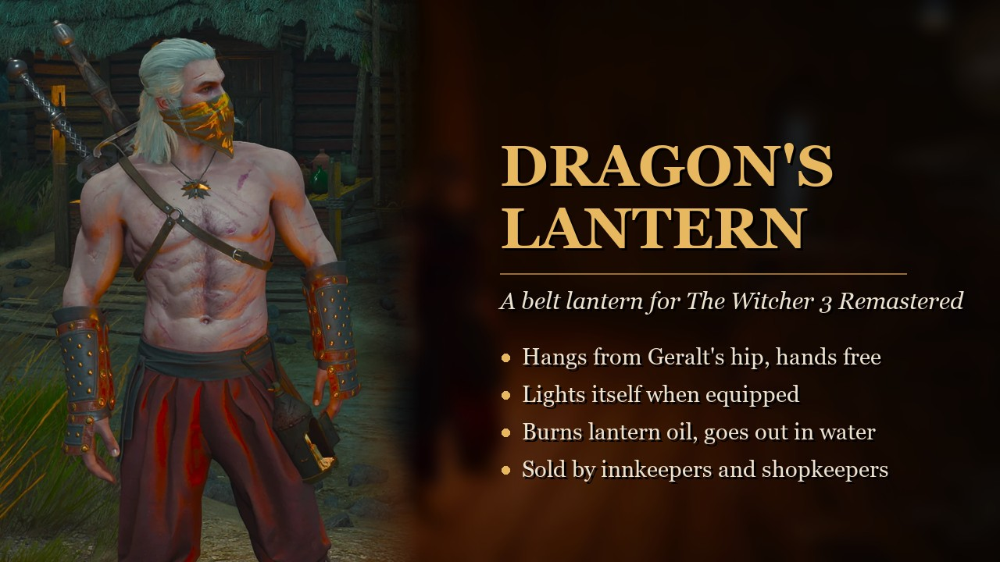

# Dragon's Lantern

A Dragon's Dogma style belt lantern for **The Witcher 3: Wild Hunt — Remastered (5.0)**.



- Hangs on Geralt's left hip (or right hip, back, front-left) while equipped in a Pockets slot. Optionally always on the belt.
- **Auto light**: lights when you put it in a Pockets (quick) slot, goes out when you take it out. It can also light only at night, or be manual only.
- Use it from the quick slot to light or douse it by hand. It never goes into his hand.
- Burns **Lantern Oil**. One flask lasts 8 game hours by default, and carried flasks refill it automatically.
- Swimming or diving **puts it out**. You relight it yourself.
- Hidden in cutscenes and dialogue. Swings as he walks, runs and rolls.
- Innkeepers and shopkeepers sell the lantern and oil.
- Everything can be adjusted under Options > Mods > Dragon's Lantern.
- Text in all 17 languages the game supports.

## Get the mod

- **Steam Workshop:** coming soon
- **Nexus Mods:** https://www.nexusmods.com/witcher3/mods/14479
- **Mod.io:** coming soon

Requires The Witcher 3 Remastered (game version 5.0 or later). Then buy the
Belt Lantern from an innkeeper or shopkeeper and put it in a Pockets slot.

## Reporting bugs

Please report bugs here on GitHub, wherever you got the mod:
**[Open a bug report](https://github.com/remathes/DragonLantern/issues/new/choose)**

The form asks for your game version, where you got the mod and what other mods
you use. If you can, open the debug console and run `ddlstatus`, then paste what
it shows. That usually pinpoints the problem.

## Learning from this mod

The whole REDkit project is here, so you can see how a script-driven mod for
the Remaster is put together:

- `workspace/scripts/local/dragonsLantern.ws`: the gameplay script. It uses
  REDkit's annotations (`@wrapMethod`, `@addMethod`, `@addField`), so no vanilla
  script is replaced and it combines well with other mods.
- `docs/REDKIT_ASSET_GUIDE.md`: how the lantern entity was made from a vanilla
  model in REDkit's Entity Editor.
- `docs/PROVENANCE.md`: which vanilla script or data file each part follows.
- `src/strings/`: translations kept in one Python file and written into
  REDkit's string database by a small script.

## Layout

```
dragonslantern.w3edit                REDkit project
workspace/                           what REDkit sees (shown as "virtualdepot")
  mods/dragons_lantern/ddl_lantern.w2ent   lantern entity (from vanilla lantern_dwarf_01)
  gameplay/items[_plus]/def_item_dragons_lantern.xml
  gameplay/gui_new/icons/inventory/ddl/    inventory icons
  scripts/local/dragonsLantern.ws
src/                                 source copies, kept in sync with workspace/
  scripts/dragonsLantern.ws          all gameplay logic
  items/def_item_dragons_lantern.xml lantern + oil item definitions
  menu/modDragonsLantern.xml         mod settings menu (goes in the game's bin\config)
  icons/                             icon PNGs
  strings/translations.py            all text, 17 languages
  strings/apply_strings.py           writes translations.py into the project string database
LocalEditorStringDataBaseW3_UTF8_mod.db   REDkit string database
docs/                                guides, provenance, changelog, store texts
```

## Building

You need The Witcher 3 Remastered and the free REDkit (Steam, GOG or Epic).

1. Open `dragonslantern.w3edit` in REDkit.
2. Script changes: edit `workspace\scripts\local\dragonsLantern.ws` and copy it to `src\`.
   REDkit compiles scripts on startup, so restart it after editing.
3. Text changes: edit `src\strings\translations.py`, close REDkit, run
   `python -I src\strings\apply_strings.py`, then Publish > Cook Mod Strings.
4. Publish > Save and publish mod project, with **Install** ticked.
5. Copy `src\menu\modDragonsLantern.xml` to the game's
   `bin\config\r4game\user_config_matrix\pc\`.

## Console commands

Commands that take values need parentheses and commas, e.g. `ddlpos(0, 2, 0)`.

| Command | Effect |
|---|---|
| `ddlgive` | Adds a Belt Lantern and 3 oil flasks |
| `ddltoggle` | Lights or douses the lantern |
| `ddlstatus` | Shows owned / spawned / lit / oil remaining |
| `ddlglow(brightness, radius)` | Sets the light (0 keeps a value); saved to the mod menu |
| `ddlpos(forward, up, out)` | Nudges placement in cm, on top of the default |
| `ddlrot(pitch, yaw, roll)` | Rotates the carrier in degrees |
| `ddlbody(pitch, yaw, roll)` | Rotates the lantern body about its own axes |
| `ddltune` / `ddlreset` | Show / clear the nudges |

## Consoles

It's unknown whether Mod.io mods on PS5/Xbox may ship scripts. This mod relies
entirely on scripts, so it targets PC.

## License

Original work in this repository is MIT licensed. The Witcher 3 game content it
builds on belongs to CD PROJEKT RED and is used under the REDkit EULA and Fan
Content Guidelines. See [LICENSE](LICENSE) and [NOTICE](NOTICE). This is a free fan project, not
affiliated with CD PROJEKT RED.
